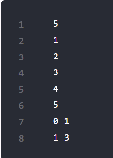
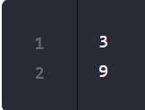

---
hide:
  - toc
---

# Sum of All Numbers in the Interval

*Edited by Charles*

**Easy · Python · Array**

[Original problem](https://www.programmercarl.com/kamacoder/0058.%E5%8C%BA%E9%97%B4%E5%92%8C.html)

!!! tip "Core idea"

    Given an array of integers, calculate the sum of numbers in the input interval.

## Python solution

```python
import sys
import sys.stdin.read

def IntervalSum():
    # Input length of the array
    data = input().split()
    index = 0
    # Input elements of the array
    n = int(data[index])
    index += 1
    vec = []
    for i in range(n):
        vec.append(int(data[index + i]))

    # Input the intervals for calculation
    index += n

    presum = [0] * n
    temp = 0
    for i in range(n):
        temp += vec[i]
        presum[i] = temp

    results = []
    while index < len(data):
        start = int(data[index])
        end = int(data[index + 1])
        index += 2

        if start == 0:
            temp_sum = presum[end]
        else:
            temp_sum = presum[end] - presum[start - 1]

        results.append(temp_sum)

    for result in results:
        print(result)
```

??? note "Explanation, examples & other approaches"

    Original study notes follow, including intermediate snippets and earlier attempts.

    Question:

    Given an array of integers, calculate the sum of numbers in the input interval.

    The input and output sample:

    

    

    The first row is the length of the integer array, n. The following n rows are elements of the array. Then, the interval start and end indices in the array are given. For example, (0, 1) → [1, 2] → 3; (1, 3) → [2, 3, 4] → 9.

??? note "Study record"

    | Field | Value |
    | --- | --- |
    | Attempts | 4 |
    | Mastery | ❚❚❚❚ |
    | The Latest Attempt | January 3, 2026 |

---

[Back to Day 2 Array II](index.md) · [All LeetCode notes](../index.md)
