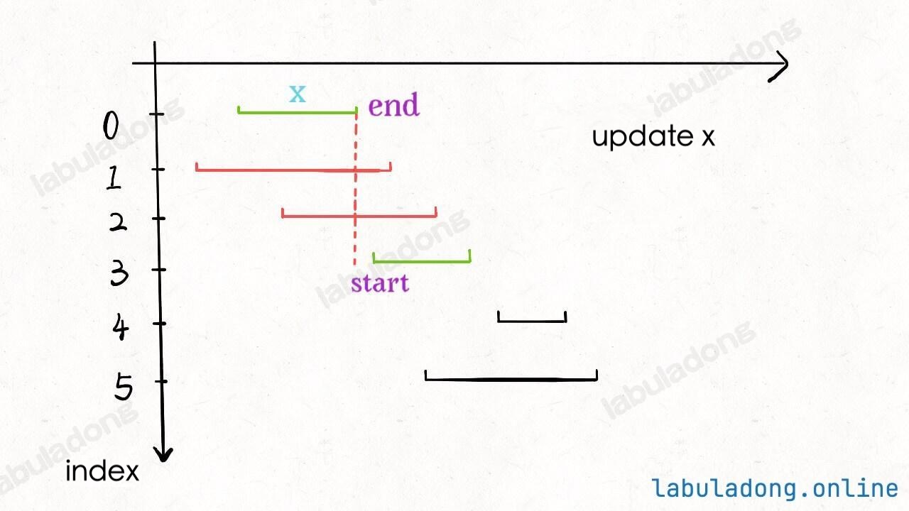

---
hide:
  - toc
---

# 452. Minimum Number of Arrows to Burst Balloons

*Edited by Charles*

**Medium · Python · Greedy**

??? question "Problem"

    [Read the original problem on LeetCode](https://leetcode.com/problems/minimum-number-of-arrows-to-burst-balloons/description/).

    The official page contains the problem statement, examples, and constraints.

??? note "Explanation, examples & other approaches"

    !!! tip "Core idea"

        Unlike [135. Candy](../day-25/135-candy.md) or [406. Queue Reconstruction by Height](../day-25/406-queue-reconstruction-by-height.md), there is no need to consider two dimensions in sorting. As the photo below, reorder points by the end so that once there is a point with the start on the right of the current recorded end, one more arrow is needed.

    Original study notes follow, including intermediate snippets and earlier attempts.

    Note:

    1. Unlike [135. Candy](../day-25/135-candy.md) or [406. Queue Reconstruction by Height](../day-25/406-queue-reconstruction-by-height.md), there is no need to consider two dimensions in sorting.
    2. As the photo below, reorder points by the end so that once there is a point with the start on the right of the current recorded end, one more arrow is needed.
    3. Since the list is reordered by the ends, intervals/points that overlap with the current interval/point must include the current end.

        

??? note "Study record"

    | Field | Value |
    | --- | --- |
    | Attempts | 1 |
    | Mastery | ❚ |
    | The Latest Attempt | January 29, 2026 |

## Python solution

```python
class Solution:
    def findMinArrowShots(self, points: List[List[int]]) -> int:
        n = len(points)
        points.sort(key = lambda x: x[1])

        arrows = 1
        end = points[0][1]

        for point in points:
            if point[0] > end:
                arrows += 1
                end = point[1]

        return arrows
```

---

[Back to Day 26 Greedy Algorithm IV](index.md) · [All Algorithm notes](../index.md)
