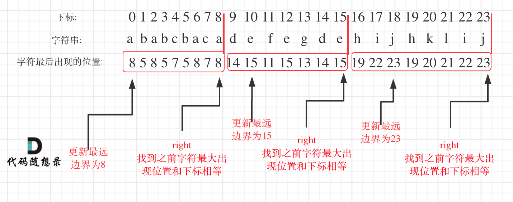

---
hide:
  - toc
---

# 763. Partition Labels

*Edited by Charles*

**Medium · Python · Greedy**

[Original problem](https://leetcode.com/problems/partition-labels/description/)

!!! tip "Core idea"

    As the following photo shows, create a dictionary to record the index of the last occurence for every character. Iterate the whole string, in each iteration, update the end of substring by

## Python solution

```python
class Solution:
    def partitionLabels(self, s: str) -> List[int]:
        letters = {}
        start = 0
        end = 0
        result = []

        for idx, char in enumerate(s):
            letters[char] = idx

        for idx, char in enumerate(s):
            end = max(end, letters[char])
            if end == idx:
                result.append(end - start + 1)
                start = end + 1

        return result
```

??? note "Explanation, examples & other approaches"

    Original study notes follow, including intermediate snippets and earlier attempts.

    Note:

    1. As the following photo shows, create a dictionary to record the index of the last occurence for every character.
    2. Iterate the whole string, in each iteration, update the end of substring by

        ```python
        end = max(end, letters[char])
        ```

        This will automatically include characters that pop up later but last occur earlier, since these characters all stay at the front of the end position. Say, ‘ababcbaca|….|….’.

    3. The update of start is independent of end, since the character at the start position may not be the end character of the substring. Say, ‘accabac|…|…’, start is always 0 until idx reaches 6, since c can reach farther than a and end is updated at idx = 1.

        

??? note "Study record"

    | Field | Value |
    | --- | --- |
    | Attempts | 1 |
    | Mastery | ❚ |
    | The Latest Attempt | January 29, 2026 |

---

[Back to Day 26 Greedy Algorithm IV](index.md) · [All LeetCode notes](../index.md)
