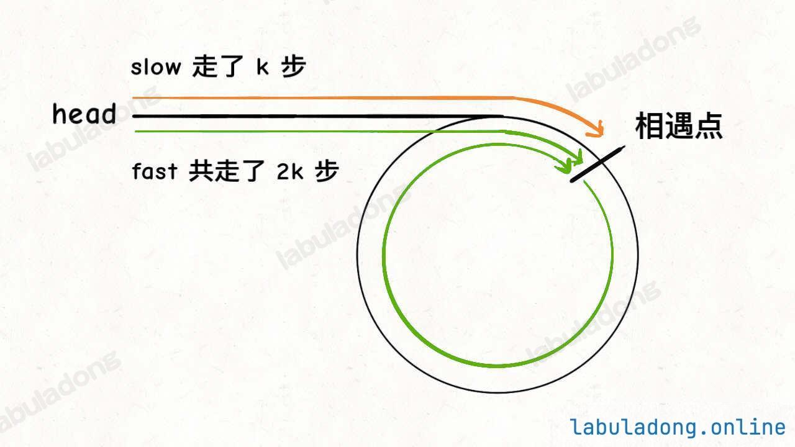
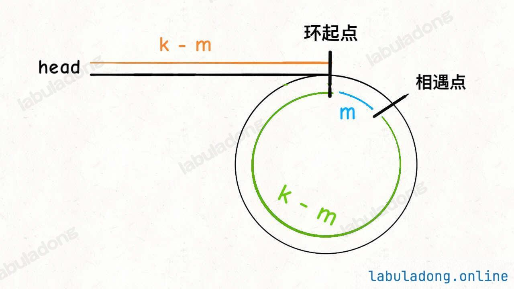

---
hide:
  - toc
---

# 142. Linked List Cycle II

*Edited by Charles*

**Medium · Python · LinkedList**

??? question "Problem"

    [Read the original problem on LeetCode](https://leetcode.com/problems/linked-list-cycle-ii/description/).

    The official page contains the problem statement, examples, and constraints.

!!! tip "Core idea"

    Define two pointers, slow and fast. As long as fast is None and [fast.next](http://fast.next) is not None, move slow and fast forward respectively one step and two steps.

    **Note:** the pointer slow and the pointer fast start together at head.

## Python solution

```python
# Definition for singly-linked list.
# class ListNode:
#     def __init__(self, x):
#         self.val = x
#         self.next = None

class Solution:
    def detectCycle(self, head: Optional[ListNode]) -> Optional[ListNode]:
        slow, fast = head, head

        while fast and fast.next:
            slow = slow.next
            fast = fast.next.next

            if slow == fast:
                break

        if not fast or not fast.next:
            return None

        counter = head

        while counter != fast:
            counter = counter.next
            fast = fast.next

        return counter
```

??? note "Explanation, examples & other approaches"

    Original study notes follow, including intermediate snippets and earlier attempts.

    1. Define two pointers, slow and fast.
    2. As long as fast is None and [fast.next](http://fast.next) is not None, move slow and fast forward respectively one step and two steps.
    3. There are two ways to break the while loop:
        1. fast or [fast.next](http://fast.next) is None, i.e. reaching the tail of the list and no cycle.
        2. slow meets fast (manual break).
    4. Check how the loop is broken. If no cycle, return None as required.
    5. If slow meets fast, set a new pointer counter from head. Let counter and fast now move forward only by one step each time. When they meet with each other, the current node is the start of the cycle; see the logic in the below graphs.

    

    

    **Note:** the pointer slow and the pointer fast start together at head.

    1. When they meet up, if slow moves k steps, then fast moves 2k steps.
    2. Assume they meet after m steps from the first node of the cycle.
    3. The pointer fast now is in the meetup point.
    4. If there is a new pointer, counter, set off from head now with the same pace as fast (one step each time), after k - m steps, they will meet again. Noted that the number k - m does not matter. What matters is counter and fast will meet up at the beginning node of the cycle.

??? note "Study record"

    | Field | Value |
    | --- | --- |
    | Attempts | 2 |
    | Mastery | ❚❚ |
    | The Latest Attempt | January 5, 2026 |

---

[Back to Day 4 Linked List II](index.md) · [All Algorithm notes](../index.md)
