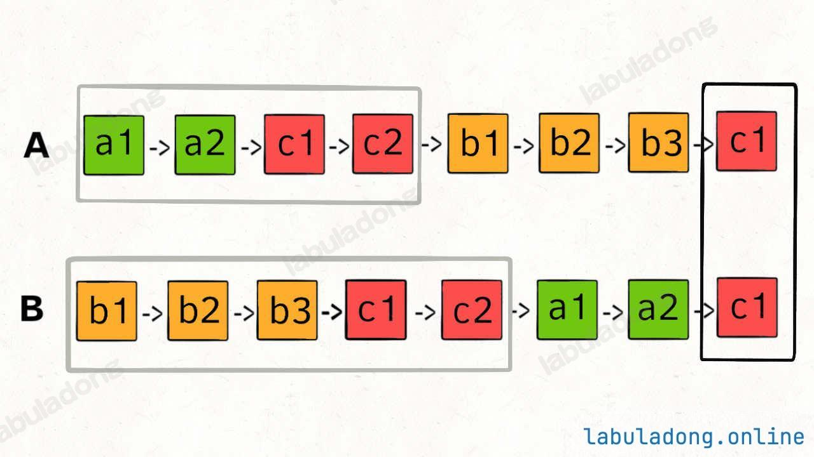

---
hide:
  - toc
---

# 160. Intersection of Two Linked Lists

*Edited by Charles*

**Easy · Python · LinkedList**

[Original problem](https://leetcode.com/problems/intersection-of-two-linked-lists/description/)

!!! tip "Core idea"

    Fast and slow pointers do not work in this scenario. Assume two pointers set off respectively at the headA and headB. When they reach None in the end, redirect them to the other list.

## Python solution

```python
# Definition for singly-linked list.
# class ListNode:
#     def __init__(self, x):
#         self.val = x
#         self.next = None

class Solution:
    def getIntersectionNode(self, headA: ListNode, headB: ListNode) -> Optional[ListNode]:
        p1, p2 = headA, headB

        while p1 != p2:
            if not p1:
                p1 = headB
            else:
                p1 = p1.next

            if not p2:
                p2 = headA
            else:
                p2 = p2.next

        return p1
```

??? note "Explanation, examples & other approaches"

    Original study notes follow, including intermediate snippets and earlier attempts.

    1. Fast and slow pointers do not work in this scenario.
    2. Assume two pointers set off respectively at the headA and headB. When they reach None in the end, redirect them to the other list.
    3. Thus, if two lists meet up at a certain node, two pointers will equal to each other on the second iteration.
    4. If two lists do not meet up at a certain node, both of them finally will become None.
    5. Both scenarios break the while loop (p1 ≠ p2).
    6. **Note**: the reason why p1 and p2 are checked in if condition instead of [p1.next](http://p1.next) and [p2.next](http://p2.next) is that considering two lists that do not meet up, we need to allow p1 and p2 to be None, or there will be infinite loop, since the only place for two pointers equal to each other is None.
    7. See the logic in below graph.

    

??? note "Study record"

    | Field | Value |
    | --- | --- |
    | Attempts | 2 |
    | Mastery | ❚❚ |
    | The Latest Attempt | January 5, 2026 |
    | Feedback | This question is quite tricky! Strongly recommended for multiple attempts! |

---

[Back to Day 4 Linked List II](index.md) · [All Algorithm notes](../index.md)
