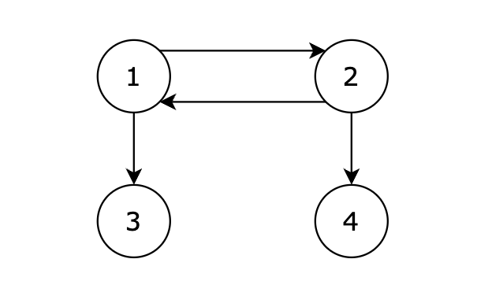

---
hide:
  - toc
---

# Full Reachability in a Directed Graph

*Edited by Charles*

**Medium · Python · Graph**

??? question "Problem"

    You are given a **directed graph** with `n` nodes labeled from `1` to `n`.

    The graph is represented by a list of directed edges, where:

    ```text
    [s, t]
    ```

    represents a directed edge from node `s` to node `t`.

    Starting from node `1`, determine whether **every node in the graph can be reached** by following the directed edges.

    Return:

    - `1` if every node can be reached from node `1`.
    - `-1` otherwise.

    ## Example 1

    **Input:**

    ```python
    n = 4
    edges = [
        [1, 2],
        [2, 1],
        [1, 3],
        [2, 4]
    ]
    ```

    

    ### Sample Output

    ```text
    1
    ```

    ### Explanation

    As shown in the figure, starting from node **1**, we can reach nodes **2**, **3**, and **4**. Therefore, all nodes are reachable, and the answer is **1**.

    The graph contains the following directed edges:

    ```text
    1 → 2
    2 → 1
    1 → 3
    2 → 4
    ```

    Starting from node `1`:

    ```text
    1 → 2
    1 → 3
    1 → 2 → 4
    ```

    Therefore, nodes `1`, `2`, `3`, and `4` are all reachable from node `1`.

    Return:

    ```text
    1
    ```

    ## Example 2

    **Input:**

    ```python
    n = 5
    edges = [
        [1, 2],
        [2, 3],
        [4, 5]
    ]
    ```

    **Output:**

    ```text
    -1
    ```

    **Explanation:**

    Starting from node `1`, we can reach:

    ```text
    1 → 2 → 3
    ```

    However, nodes `4` and `5` cannot be reached from node `1`.

    Therefore, not every node is reachable.

    Return:

    ```text
    -1
    ```

    ## Example 3

    **Input:**

    ```python
    n = 3
    edges = [
        [1, 2],
        [2, 3]
    ]
    ```

    **Output:**

    ```text
    1
    ```

    **Explanation:**

    Starting from node `1`:

    ```text
    1 → 2 → 3
    ```

    All nodes are reachable from node `1`.

    Return:

    ```text
    1
    ```

    ## Constraints

    ```text
    1 <= n <= 100
    1 <= edges.length <= 2000
    1 <= edges[i][0], edges[i][1] <= n
    ```

    Each edge `[s, t]` represents a **directed edge** from node `s` to node `t`.

!!! tip "Core idea"

    This problem is a basic **directed graph traversal** problem.

## Python solution

```python
from typing import List

class Solution:
    def canReachAllNodes(self, n: int, edges: List[List[int]]) -> int:
        graph = [[] for _ in range(n + 1)]

        for s, t in edges:
            graph[s].append(t)

        visit = [False] * (n + 1)

        def dfs(i):
            if visit[i]:
                return

            visit[i] = True

            for neighbor in graph[i]:
                dfs(neighbor)

        dfs(1)

        for i in range(1, n + 1):
            if not visit[i]:
                return -1

        return 1
```

??? note "Explanation, examples & other approaches"

    Original study notes follow, including intermediate snippets and earlier attempts.

    ## Python


    ## Idea

    This problem is a basic **directed graph traversal** problem.

    We are given `n` nodes and a list of directed edges:

    ```text
    [s, t]
    ```

    which means there is a directed edge:

    ```text
    s → t
    ```

    We need to determine whether **every node can be reached from node `1`**.

    The main idea is:

    > Build an adjacency list, start DFS from node `1`, and mark every reachable node as visited.
    >

    After DFS finishes, if every node from `1` to `n` has been visited, return `1`. Otherwise, return `-1`.

    ## Step 1: Build the Adjacency List

    The input gives us a list of edges:

    ```python
    edges = [
        [1, 2],
        [2, 1],
        [1, 3],
        [2, 4]
    ]
    ```

    We convert it into an adjacency list:

    ```text
    graph[1] = [2, 3]
    graph[2] = [1, 4]
    graph[3] = []
    graph[4] = []
    ```

    We can initialize the graph with:

    ```python
    graph = [[] for _ in range(n + 1)]
    ```

    Since the nodes are numbered from `1` to `n`, using size `n + 1` makes indexing easier.

    Then:

    ```python
    for s, t in edges:
        graph[s].append(t)
    ```

    ### Important: This Is a Directed Graph

    For an edge:

    ```text
    1 → 2
    ```

    we only add:

    ```python
    graph[1].append(2)
    ```

    We should **not** add:

    ```python
    graph[2].append(1)
    ```

    unless the reverse edge actually exists in `edges`.

    ## Step 2: Use a Visited Array

    Create:

    ```python
    visit = [False] * (n + 1)
    ```

    where:

    ```text
    visit[i] = True
    ```

    means node `i` can be reached from node `1`.

    Initially:

    ```text
    visit = [False, False, False, ..., False]
    ```

    ## Step 3: DFS

    Start DFS from node `1`:

    ```python
    dfs(1)
    ```

    When visiting a node:

    ```python
    visit[i] = True
    ```

    Then recursively visit all of its outgoing neighbors:

    ```python
    for neighbor in graph[i]:
        dfs(neighbor)
    ```

    The DFS logic is:

    ```python
    def dfs(i):
        if visit[i]:
            return

        visit[i] = True

        for neighbor in graph[i]:
            dfs(neighbor)
    ```

    ## Why Do We Need `visit`?

    The graph may contain cycles.

    For example:

    ```text
    1 → 2
    ↑   ↓
    └───┘
    ```

    Without a visited array, DFS could repeatedly traverse:

    ```text
    1 → 2 → 1 → 2 → 1 → ...
    ```

    and never stop.

    Therefore:

    ```python
    if visit[i]:
        return
    ```

    prevents us from processing the same node multiple times.

    ## Step 4: Check Whether All Nodes Were Visited

    After:

    ```python
    dfs(1)
    ```

    we check every node:

    ```python
    for i in range(1, n + 1):
        if not visit[i]:
            return -1
    ```

    If any node was not visited, that node cannot be reached from node `1`.

    Otherwise:

    ```python
    return 1
    ```

    ## Hand Simulation

    Consider:

    ```python
    n = 4

    edges = [
        [1, 2],
        [2, 1],
        [1, 3],
        [2, 4]
    ]
    ```

    The adjacency list is:

    ```text
    1 → [2, 3]
    2 → [1, 4]
    3 → []
    4 → []
    ```

    Start:

    ```text
    dfs(1)
    ```

    Visit node `1`:

    ```text
    visit:

    1 = True
    2 = False
    3 = False
    4 = False
    ```

    From node `1`, visit node `2`:

    ```text
    1 → 2
    ```

    Now:

    ```text
    1 = True
    2 = True
    3 = False
    4 = False
    ```

    Node `2` has neighbors:

    ```text
    1, 4
    ```

    Node `1` has already been visited:

    ```python
    if visit[1]:
        return
    ```

    So we skip it.

    Then visit node `4`:

    ```text
    1 → 2 → 4
    ```

    Now:

    ```text
    1 = True
    2 = True
    3 = False
    4 = True
    ```

    Return to node `1` and visit node `3`:

    ```text
    1 → 3
    ```

    Finally:

    ```text
    1 = True
    2 = True
    3 = True
    4 = True
    ```

    Every node is reachable, so:

    ```text
    return 1
    ```

    ## Unreachable Example

    Suppose:

    ```python
    n = 5

    edges = [
        [1, 2],
        [2, 3],
        [4, 5]
    ]
    ```

    The graph looks like:

    ```text
    1 → 2 → 3

    4 → 5
    ```

    Starting from node `1`, DFS can only visit:

    ```text
    1, 2, 3
    ```

    Therefore:

    ```text
    visit[4] = False
    visit[5] = False
    ```

    When checking all nodes:

    ```python
    if not visit[4]:
        return -1
    ```

    So the answer is:

    ```text
    -1
    ```

    ## General Graph Traversal Pattern

    This problem follows a very common graph traversal pattern:

    ```text
    Edge List
       ↓
    Build Adjacency List
       ↓
    DFS / BFS From Source
       ↓
    Mark Visited Nodes
       ↓
    Check Reachability
    ```

    This pattern can be reused for many graph reachability problems.

    ## Complexity Analysis

    Let:

    ```text
    V = number of nodes
    E = number of edges
    ```

    ### Time Complexity

    ```text
    O(V + E)
    ```

    Each node is visited at most once, and each directed edge is examined at most once.

    ### Space Complexity

    ```text
    O(V + E)
    ```

    The adjacency list requires:

    ```text
    O(V + E)
    ```

    The `visit` array requires:

    ```text
    O(V)
    ```

    The DFS recursion stack can require up to:

    ```text
    O(V)
    ```

    in the worst case.

    ## Summary

    ```text
    1. Build an adjacency list from the directed edges.
    2. Create a visited array.
    3. Start DFS from node 1.
    4. Mark every reachable node as visited.
    5. Use visited to prevent cycles and repeated traversal.
    6. Check nodes 1 through n.
    7. If any node is unvisited, return -1.
    8. Otherwise, return 1.
    ```

    The key idea is:

    > **To determine whether all nodes are reachable from a source, traverse the graph from that source and check whether every node has been visited.**
    >

??? note "Study record"

    | Field | Value |
    | --- | --- |
    | Attempts | 1 |
    | Mastery | ❚ |
    | The Latest Attempt | August 20, 2026 |

---

[Back to Day 46 Graph IV](index.md) · [All Algorithm notes](../index.md)
