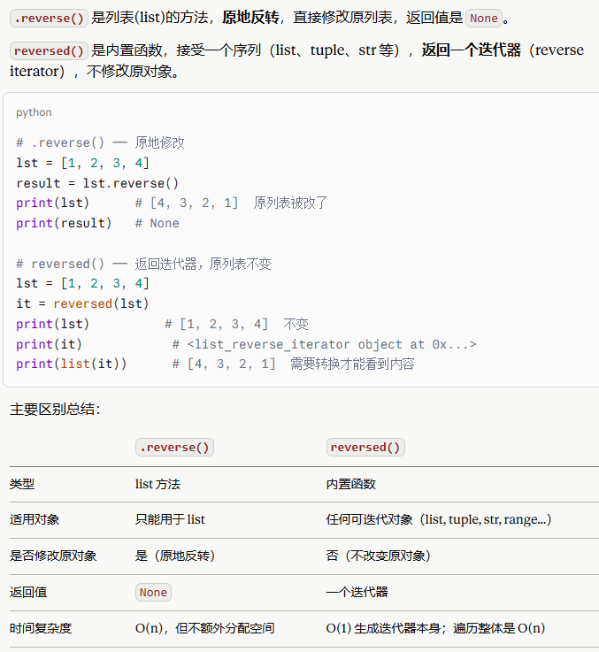

---
hide:
  - toc
---

# 541. Reverse String II

*Edited by Charles*

**Easy · Python · String**

[Original problem](https://leetcode.com/problems/reverse-string-ii/)

!!! tip "Core idea"

    This solution is based on the solution to [344. Reverse String](344-reverse-string.md) We need to  convert the string into a list of characters in the string.

## Python solution

```python
class Solution:
    def reverseStr(self, s: str, k: int) -> str:
        n = len(s)
        result = list(s)

        for i in range(0, n, 2 * k):
            result[i: i + k] = self.reverseSubstr(result[i: i + k])

        return ''.join(result)

    def reverseSubstr(self, s):
        l = len(s)
        left, right = 0, l - 1

        while left < right:
            s[left], s[right] = s[right], s[left]
            left += 1
            right -= 1

        return s
```

??? note "Explanation, examples & other approaches"

    Original study notes follow, including intermediate snippets and earlier attempts.

    Note:

    1. This solution is based on the solution to [344. Reverse String](344-reverse-string.md)
    2. We need to  convert the string into a list of characters in the string.
    3. Iterate the whole list every 2*k step and only operate reversing on first k elements.


    

??? note "Study record"

    | Field | Value |
    | --- | --- |
    | Attempts | 1 |
    | Mastery | ❚ |
    | The Latest Attempt | January 6, 2026 |

---

[Back to Day 7 String I](index.md) · [All LeetCode notes](../index.md)
